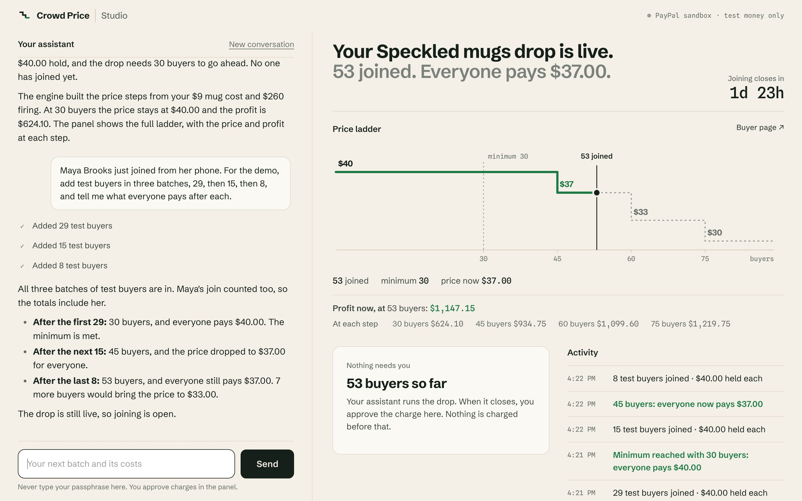

# Crowd Price

Sell a batch before you make it. Buyers join a drop with a PayPal hold, the price steps down for everyone as more
people join, and nobody is charged until the drop closes and the maker approves the charge.

An AI assistant runs the drop for the maker, over MCP or the command line. It never sets a price and it cannot
approve a charge: a deterministic engine does the arithmetic and moves the money, and a person approves every
charge with a passphrase the assistant never sees.

Built for the PayPal AI Hackathon on PayPal Orders v2 (authorize), Payments v2 (partial final capture, void) and
Transaction Search. It runs in test mode with no PayPal account, or against your own PayPal sandbox app.



**[Watch the demo (2 minutes)](https://youtu.be/DuKyrlzw0Sc)**: the maker runs a drop from a chat while the drop page fills, then approves the charge.

## Juniper's drop

Juniper is a potter. A kiln firing costs her $260 however many mugs are in it, and each mug costs $9 in clay and
glaze, so she wants at least 30 buyers before she fires. Today she would take pre-orders and refund them if the batch
falls short, or she would guess.

She opens a drop for speckled mugs. The engine proposes a price ladder from her costs, with her profit at each step
after PayPal's fees:

| Buyers | Everyone pays | Juniper's profit at that count |
|---:|---:|---:|
| 30 (the minimum) | $40.00 | $624.10 |
| 45 | $37.00 | $934.75 |
| 60 | $33.00 | $1,099.60 |
| 75 | $30.00 | $1,219.75 |

Maya joins from her phone. PayPal places a $40.00 hold on her card; nothing is charged. When the drop closes with 53
buyers, each hold is captured once at $37.00 and the other $3.00 is released. Had only 22 people joined, every hold
would have been released and nobody would have paid. A step, once reached, stays reached: if someone leaves after
the crowd passes 45, the price stays at $37.00.

The bigger the crowd, the lower everyone's price, which gives buyers a reason to bring friends. Juniper fires the
kiln only when the batch is paid for.

## How it works

- **Holds, not charges.** Each buyer is an Orders v2 order with `intent: AUTHORIZE` for the starting price. The
  maker's balance does not move until settlement.
- **One charge, at the final price.** Settlement captures each hold once with `final_capture: true`, so PayPal
  releases the rest. Below the minimum, every authorisation is voided.
- **The engine decides, the assistant explains.** Prices, totals and counts come only from the engine. The assistant
  proposes, opens, watches and explains a drop, and copies the engine's numbers; it cannot pick or compute one.
- **A person approves the exact plan.** `drop settle` stops with `needs_approval` (exit 3) and the plan, for example
  `capture 45 holds at $37.00 = $1,665.00`. The maker approves it with an approver passphrase, in their own terminal
  (`togi approve`) or in the studio's panel. The approval is bound to that plan, works once and lapses after 15
  minutes. If anything changed, settle refuses.
- **Checked with PayPal before and after.** `drop plan` and `drop settle` read every hold at PayPal before any money
  moves. Requests carry deterministic `PayPal-Request-Id`s, and a capture is sent once and never retried, so a lost
  reply does not become a second charge. Afterwards `drop verify` reads every hold and capture back, and
  `drop tieout` checks the captures against the change in PayPal's own balance, to the cent, once PayPal has indexed
  them ([docs/closure.md](docs/closure.md)).

Rules the engine keeps, each with tests ([docs/DECISIONS.md](docs/DECISIONS.md) D-11, D-11b):

- Nobody pays more than the final price, and the engine never charges a hold twice.
- A buyer who asked to leave before the drop closed is not charged, even if PayPal errored when they asked.
- A hold the engine never confirmed (a lost reply) is released, never charged.

## Try it

Steps 1 to 6 need no PayPal account. You need:

- macOS or Linux and Python 3.11 or newer. Tested on macOS with Python 3.12. The `python3` that ships with macOS is
  older: install one from python.org or Homebrew. On Linux, Togi's code mode runs without the macOS sandbox.
- [Claude Code](https://claude.com/claude-code), installed and signed in, for the assistant (step 4) and the studio
  (step 6) only.
- Node.js, optional: 67 of the page tests run the pages' own JavaScript and are skipped without it.

### 1. Install

```bash
python3 --version                              # 3.11 or newer
git clone https://github.com/tyejcoleman/crowd-price.git
git clone https://github.com/tyejcoleman/togi.git
python3 -m venv venv && . venv/bin/activate    # activate it in every terminal you use below
python3 -m pip install pytest "mcp<2" cryptography
mkdir -p ~/.local/bin && ln -sf "$PWD/togi/bin/togi" ~/.local/bin/togi
export PATH="$HOME/.local/bin:$PATH"           # if ~/.local/bin is not on your PATH already
togi add ./crowd-price
cd crowd-price
```

Togi runs the first `python3` on your PATH, which is why the virtual environment has to be active.

### 2. Run the tests

```bash
TOGI_SRC=$PWD/../togi/src PYTHONPATH=../togi/src python3 -m pytest -q
```

Expect `935 passed, 6 skipped` in a few minutes (with Node.js installed). The skips are the opt-in live sandbox
tests and one opt-in run of the real assistant (`CROWD_STUDIO_REAL_CLAUDE=1`). The tests use test mode: a stand-in
for PayPal built from what the sandbox actually answered ([docs/DECISIONS.md](docs/DECISIONS.md) F-08 to F-17).

### 3. Set up the approver, once

Money commands need a person. Run these yourself, in a real terminal, before you start any assistant: until an
approver exists, any process that can open a terminal could create one.

```bash
togi approver setup    # choose a passphrase of 12+ characters; stored as a hash in ~/.togi/approver.d
togi lock crowd        # review the money code, then type the confirmation word and your passphrase
```

Money commands run only locked code, and a lock is signed with this machine's own key, so a fresh clone has to be
locked here. Without it, `drop settle` refuses with exit 2 (`lock_check_failed`) instead of asking for approval. The
lock is written to the repo's `.togi/` files, so git shows them as changed. Until you lock, `togi doctor` reports
crowd's audit chain as broken: the chain in the clone was signed on another machine.

### 4. A drop in test mode

The commands the assistant runs, typed by hand:

```bash
export CROWD_ENV=test CROWD_PAYPAL=fake          # test mode: no money moves
togi crowd test reset
togi crowd ladder propose --unit-cost 9 --fixed-cost 260 --minimum 30    # the ladder above, with the profit at each step
togi crowd drop create --title "Speckled mugs" --minimum 30 --hours 48 --ladder 30:40,45:37,60:33,75:30
togi crowd drop publish --drop d_...             # the id the last command printed
togi crowd sim join --drop d_... --count 30      # 30 test buyers: the minimum is met at $40.00
togi crowd sim join --drop d_... --count 15      # 45 buyers: everyone now pays $37.00
togi crowd drop close --drop d_...
togi crowd drop plan --drop d_...                # capture 45 holds at $37.00 = $1,665.00, and its expect token
togi crowd drop settle --drop d_... --expect capture:45:37.00:1665.00    # exit 3: needs approval, prints ap_...
togi approve ap_...                              # you: read the plan, type the drop id, then your passphrase
togi crowd drop settle --drop d_... --expect capture:45:37.00:1665.00 --approval ap_...
togi crowd drop verify --drop d_...              # every hold and capture read back
togi crowd drop explain --drop d_...             # what happened, in plain words
```

In a terminal the replies are readable text; an agent gets compact JSON. Every refusal names the exact command to run
next. `drop tieout` needs PayPal's transaction history, so it runs in the sandbox only (step 7).

The same drop, run by the assistant:

```bash
python3 demo/maker_agent.py --fake                      # the whole story; it stops and waits for your approval
python3 demo/maker_agent.py --fake --scenario missed    # a drop that misses its minimum: nobody pays
```

When it stops, run the `togi approve` it prints in a second terminal, then press Enter. It uses Sonnet by default
(`--model haiku` for a cheaper run) and starts from an empty test store. The assistant runs in an empty folder with
one tool: Bash, limited to `togi` commands, in Claude Code's restricted mode. See [demo/README.md](demo/README.md).

### 5. The buyer's page and the maker's view

In a second terminal, with the same settings, so both see the same drops:

```bash
export CROWD_ENV=test CROWD_PAYPAL=fake CROWD_DETAILS=web/demo/details.json
PYTHONPATH=src:web python3 -m crowdweb --maker-name Juniper
```

It prints a link for each drop and a link to the maker view. The maker key is made fresh and printed in that link,
unless you set your own with `CROWD_MAKER_KEY` (16 or more characters). `CROWD_DETAILS` names a JSON file of what each
drop sells; `web/demo/details.json` is Juniper's.

- **The drop page** is Maya's: she joins with a test card, watches the price step down as the crowd grows, can leave
  until the drop closes, and afterwards sees what she paid.
- **The maker view** is Juniper's: the ladder with her profit at each step, the activity, the buyers, and a settlement
  waiting for her approval. Once settled, it checks every hold and capture with PayPal (and, in the sandbox, runs the
  balance check).

Neither page can settle, close, exclude or bind a drop: those wait for a person in Togi. Hosting behind a proxy, and the
rare cases the pages do not handle: [web/SECURITY.md](web/SECURITY.md).

### 6. The studio: run a drop from a chat

The whole story on one page. Needs Claude Code signed in, and the approver and lock from step 3:

```bash
export CROWD_ENV=test CROWD_PAYPAL=fake CROWD_DETAILS=web/demo/details.json
python3 -I web/studio.py --maker-name Juniper    # prints the studio link with its key
```

On the left is a chat with the assistant; on the right, the drop it is working on, live: the price, the ladder with
the profit at each step, the buyers as they join, the activity. Tell it your costs ("clay and glaze are 9 dollars a
mug, the firing is 260, I need 30 sold") and it asks the engine for a ladder, opens the drop and runs it. Each thing it
does shows as a step in plain words, such as "Asked the engine for a price ladder from your costs"; open a step to see
the exact tool call and Togi's reply. On a phone, the chat and the drop are two tabs.

When the drop closes, the assistant asks to settle and the panel shows what you would sign: how many buyers are
charged how much, the total, what goes back from each hold, the drop, and how long the approval lasts. Approve with
your approver passphrase, or choose "Not now" and nothing is charged. The assistant then settles, checks every charge
with PayPal and explains the outcome.

How the approval stays with you:

- **It is Togi's own check.** The panel uses Togi's approval desk (`togi.desk`), which recomputes the request from the
  live repo exactly as `togi approve` does. Your approval is bound to what you were shown; if the request, the plan or
  the locked code changed since, nothing is approved. It uses the same approver, the same lock-out after five wrong
  passphrases, and the same signed, single-use, 15-minute grant as the terminal.
- **Only a server you started can approve.** The desk opens once, as the studio starts, and refuses under an agent
  (`TOGI_AGENT`, `togi run`), in an interpreter that is not isolated, without an approver, and, for your own approver,
  without a terminal. If it did not open, the panel shows the `togi approve` command and says why.
- **The passphrase goes from your browser to that check and nowhere else**: not to the assistant, its context, a log
  or the disk.
- **The card shows only what Togi signed.** The drop's name is the assistant's own words, so the card quotes it, cuts
  it short, shows any character that could hide or reorder text as its code, and labels it "your assistant's name for
  it". A request the card cannot read gets no approve button.
- **The assistant has the drop tools and nothing else.** It is `claude -p` on your own Claude plan
  (`ANTHROPIC_API_KEY` is removed from its environment) with no built-in tools (`--tools ""`), in restricted mode, and
  one MCP server: `togi mcp serve crowd`, behind a gate that lists and passes only the tools a maker needs. It does not
  have the studio's key. Buyer names and drop titles reach it only as data inside tool replies.
- **The studio listens on 127.0.0.1 only.** Every route needs the key, and every POST must come from the studio page.

Options: `--port` (8790), `--model` (sonnet), `--maker-key` or `CROWD_MAKER_KEY`, `--claude`, and `--togi` (the Togi
launcher the assistant's tools run; the desk uses the same Togi). With a throwaway test approver (`TOGI_APPROVER_HOME`
set), the desk opens without a terminal; what it signs is test scope, and Crowd Price accepts it only in test mode. On
the PayPal sandbox only your own approver counts.

One limit to know: Togi tells your own approver from a test one by where its files are. **A plain copy of your
approver's files, used as a test approver, is not detected.** What it signs is still test scope, which Crowd Price
accepts only in test mode, and anything that can read your files could make a test approver of its own anyway. The full
threat model is in [web/SECURITY.md](web/SECURITY.md).

### 7. The same in the PayPal sandbox

Create a free sandbox app at [developer.paypal.com](https://developer.paypal.com/) (Apps & Credentials, Sandbox), then:

```bash
cp .env.example .env     # add the sandbox app's client id and secret; keep PAYPAL_ENV=sandbox
unset CROWD_ENV CROWD_PAYPAL
python3 demo/maker_agent.py --scenario missed    # a short run with real sandbox holds
```

Test buyers pay with PayPal's published sandbox test card numbers (listed in `src/crowd/paypal_holds.py`); no real
card is ever used. The client refuses to start unless `PAYPAL_ENV=sandbox`, and the sandbox address is fixed in the
code. `drop tieout` needs PayPal to have indexed the captures, which can take a few hours; until then it refuses and
says so. The live tests: `CROWD_LIVE=1 PYTHONPATH=../togi/src python3 -m pytest -s -q tests/crowd/test_live.py`.

## The same tools from any MCP client or the command line

The studio is one client of Crowd Price; the engine does not know which agent drives it. Any agent gets the same
commands, under the same rule that money waits for a person:

```bash
togi skill crowd                      # what an agent reads first: the commands, the rules, the next step
togi tools crowd --json               # the same commands as a JSON tool list
togi crowd drop status --drop d_...   # the CLI: compact JSON for an agent, the exact next command on every refusal
togi mcp serve crowd                  # an MCP server over stdio: crowd_skill, crowd_drop_create, ...
```

For an MCP client such as Claude Desktop, an IDE or your own, use absolute paths. A desktop app may not start with
your shell's PATH, and Togi runs the `python3` it finds there, which has to be the virtual environment's (it has `mcp`):

```json
{"mcpServers": {"crowd": {
  "command": "/absolute/path/to/togi/bin/togi",
  "args": ["mcp", "serve", "crowd"],
  "env": {"PATH": "/absolute/path/to/venv/bin:/usr/bin:/bin", "TOGI_AGENT": "my-agent",
          "CROWD_ENV": "test", "CROWD_PAYPAL": "fake"}}}}
```

A money tool (`crowd_drop_settle`) returns `needs_approval` with an approval id. A person approves it with
`togi approve` in their terminal or in the studio's panel, and the agent then calls the tool again with `approval`. No
MCP tool, command or flag can grant an approval.

## Hackathon submission

### What is new

Everything here was written during the submission period; the first commit is 26 Oct 2026. Crowd Price runs on
[Togi](https://github.com/tyejcoleman/togi), an agent-native command-line host by the same author, also started in the
submission period (26 Oct 2026) and published as its own open-source project.

Code and assets from elsewhere: the Python standard library; the `mcp` package (below 2.0) and the packages it
installs, for the MCP server and the studio; `pytest` for the tests; and two Google Fonts (Schibsted Grotesk and
Spline Sans Mono), which the pages load from fonts.googleapis.com.

### PayPal APIs used

- `POST /v1/oauth2/token`: client credentials.
- Orders v2: `POST /v2/checkout/orders` (one order per buyer, `intent: AUTHORIZE`, a sandbox test card),
  `POST /v2/checkout/orders/{id}/authorize` (the hold), `GET /v2/checkout/orders/{id}` (the captures and refunds on an
  order, to recover from lost replies and to check refunds).
- Payments v2: `POST /v2/payments/authorizations/{id}/capture` (one partial, final capture at the final price),
  `POST /v2/payments/authorizations/{id}/void` (a missed minimum, a buyer who left, the rest of a partly captured hold),
  `GET /v2/payments/authorizations/{id}` (every hold read back before money moves, and in verify),
  `GET /v2/payments/captures/{id}`.
- Reporting, for the tie-out: `GET /v1/reporting/transactions` (unfiltered, every page, in 31-day windows) and
  `GET /v1/reporting/balances` (`as_of_time`).

### AI tools used

- **In the product:** Claude, through Claude Code (`claude -p`, Sonnet by default, Haiku for cheaper runs), is the
  maker's assistant in `demo/maker_agent.py` and in the studio (`web/studio.py`). It learns Crowd Price from
  `togi skill crowd` ([skills/](skills/)) and acts only through the Crowd Price commands. Togi serves the same commands
  as a CLI, a JSON tool list, a code-mode API (`togi run`) and MCP tools (`togi mcp serve`), so any agent can drive
  them.
- **Machine-checked agent tasks:** [stone/tasks](stone/tasks) holds 7 tasks (2 held out) that an agent must complete
  in test mode: open a drop, report the price after joins, request settlement, handle a missed minimum, a leave after a
  step locked, explain an outcome, and recover from a wrong flag.
- **In development:** built with Claude Code. The author designed the product and directed the work; Claude models
  wrote and reviewed code under that direction. Five independent review rounds tried to break the money rules. Each
  finding became a fix with a regression test, except one race that cannot be closed from our side (see Limits):
  [docs/crowd-fixes-r1.md](docs/crowd-fixes-r1.md) to [r5](docs/crowd-fixes-r5.md).

## How it was checked

- 935 offline tests in test mode: 611 for the engine and its commands, including real threads racing on the store's
  file lock; 30 for the balance certifier, on a recorded sandbox fixture; and 294 for the pages and the studio (only
  the engine's numbers are shown; a join asked again after a lost reply is handed back, never placed twice; a browser
  can release only the hold it placed; names that hide or reorder text are refused; no route settles).
- Live sandbox tests (`tests/crowd/test_live.py`): a funded drop, a missed minimum, a leave after a step locked, and a
  capture made to fail, each followed by `drop verify`, with PayPal's ids in a printed report. Last run on 8 Nov 2026, on the submitted code: 5 passed
  ([docs/DECISIONS.md](docs/DECISIONS.md) F-21; earlier runs F-10 and F-14).
- What the sandbox actually answered, and where it differs from PayPal's documentation, is recorded in
  [docs/DECISIONS.md](docs/DECISIONS.md) F-08 to F-17, with the probes still to run.

## Limits

- Built and tested for the PayPal sandbox only; not reviewed for real money.
- PayPal honours a hold's full amount for 3 days (the authorisation lasts 29), so a drop runs for at most 72 hours;
  the engine refuses longer. Reauthorising after day 3 is untested.
- Buyers pay with sandbox test cards, which the server sends to PayPal (Orders v2 with a card payment source). There
  is no PayPal wallet checkout yet.
- One product and one currency (USD) per drop. No shipping or tax.
- If someone captures a hold outside the engine in the moment between the engine's last read of it and its own
  capture, PayPal can accept both. `drop verify` then reports the hold as charged above the final price and names the
  capture to refund ([docs/DECISIONS.md](docs/DECISIONS.md) F-16).
- Togi's guarantees hold when the agent reaches tools only through Togi: a shell restricted to `togi`, code mode, or
  MCP. An agent with an unrestricted shell running as the same user could edit Togi itself.

## Repository layout

- `src/crowd/`: the engine (`engine.py`), the price ladder (`ladder.py`), the PayPal holds client and the test-mode
  stand-in (`paypal_holds.py`), the event store (`store.py`), the settlement check (`verify.py`) and the Togi bundle
  (`togi_bundle.py`)
- `src/closure/`: the balance certifier behind `drop tieout` ([docs/closure.md](docs/closure.md))
- `web/crowdweb/`: the drop page, the maker view and the studio (a standard-library server with plain HTML, CSS and
  JavaScript), started by `python3 -m crowdweb` and `web/studio.py`; tests in `web/tests/`
- `skills/`: what the assistant reads; `stone/tasks/`: the agent tasks; `togi.toml`: tiers, locks and policy
- `demo/`: the command-line assistant; `tests/`: the engine and certifier tests; `harness/`: the sandbox seeder and
  checks; `eval/`: the certifier's scorecard

## License

MIT. See [LICENSE](LICENSE).
